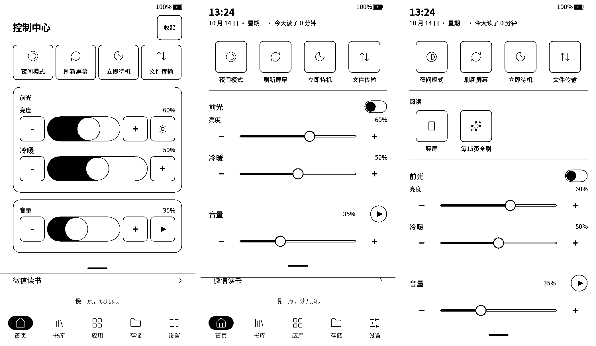

# Plus 控制中心重设计（第二版）

2026-10-14。第一版（方框快捷键、88 px 胶囊滑条、单独「收起」按钮）被用户评价为太潦草，按 Pico 的控制中心重做，Plus 只多出前光和音量两段。

左：第一版；中：主页上打开；右：阅读时打开（多出「阅读」一段）。横屏见 [plus-control-center-landscape.png](control-center/plus-control-center-landscape.png)。截图来自 Plus 模拟器预览（`scripts/prepare_plus_recorder_preview.py`，前光在预览里模拟为双路），不是实机照片。

## 结构

- **顶部**：大号时间 + 电量，下一行「日期 · 今天读了 N 分钟」。不再有「控制中心」标题和「收起」按钮；用底部把手、上滑、返回键或点面板外收起，与 Pico 一致。
- **快捷操作**：夜间模式、刷新屏幕、立即待机、文件传输。Pico 的 112 px 圆角方块，下方文字，开启时反白。
- **阅读**（只在阅读时）：方向、全刷间隔，同样的方块。
- **前光**：标题行右侧是开关（胶囊 + 圆形滑块，开为墨底）。下面亮度、冷暖各一行：上方名称和百分比，下方 [−] 细轨道 + 圆形滑块 [+]。
- **音量**：标题行显示百分比和圆形试听按钮，下方同样的滑条。
- **横屏**：快捷操作和阅读两项合成一行六个；亮度（带开关）、冷暖、音量分三栏，每栏标题行显示数值，滑条对齐。

## 规格

- 触控区一律 ≥ 88×88，相邻触控区间距 ≥ 8 px：快捷方块的命中区每侧内缩 4 px；标题行高 64 px，开关和试听的命中区上下各伸出 12 px，因此无说明行的滑条前留 20 px。
- 滑条：轨道 8 px、2 px 描边、已选部分填墨；圆形滑块 40 px、3 px 描边。轨道两端正好是滑块中心的两个极限，拖动位置（命中框内 0–1000）与滑块位置一致。
- [−]/[+] 只画符号，按下时变成墨底圆角方块。
- 线宽、圆角、方块尺寸都取 `RickyDesignTokens.h`。

## 实现与验证

`FrontlightPanelActivity`：新增 `sectionHead()`、`sliderRow()`，`roundActionRow()`/`buildRickyPanel()`/`rickyPanelHeight()` 按 Pico 版重写；亮度、冷暖、音量、试听、开关的事件处理和保存逻辑不变。去掉 324 字节的 `SliderRowProps` 成员，固件比上一版小约 1 KB（5,232,560 字节）。

- `tests/test_plus_control_center_layout.py`：编译真实的五个布局方法和真实 FreeInkUI，用 RickyOS 高 DPI 间距，跑 32 种组合（横竖屏 × 阅读 × 前光 × 冷暖 × 音频）；检查测量高度与实际绘制完全一致、滑条/开关/试听数量正确、所有触控区 ≥ 88×88 且相互间隔 ≥ 8 px、不溢出。ASan/UBSan 通过。
- `tests/test_plus_frontlight_panel.py`：真实回调的边界、重复写入、关灯记忆、保存时机与高度。
- 完整 `tests/run_plus_port_tests.sh` 与 Plus 固件构建通过。实机观感和拖动手感待上机确认。
